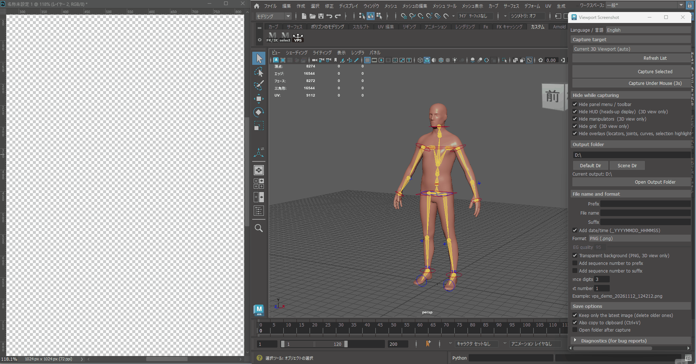

# Viewport Screenshot to Clipboard for Maya (Free Edition)



> **Capture clean Maya viewports directly to your clipboard (`Ctrl+V`) — no manual UI hiding or cropping required.**

A lightweight Maya Python tool to capture the current viewport directly to your OS clipboard with a single click.
No saving temporary image files, no manual cropping—just hit **Ctrl + V** anywhere (Discord, Slack, Notion, PureRef, Photoshop, etc.).

🔥 **Launch Sale Active (until Nov 29):**
Check out the **Pro Edition** (with **Transparent Background / Alpha PNG** capture) on [Gumroad (Global)](https://mashitaya.gumroad.com/l/ysgtzm/LAUNCH) or [BOOTH (Japan)](https://yworks.booth.pm/items/9112055).

---

## ⚡ Features (Free Edition)

* **Instant Clipboard Copy:** Copies the viewport render straight to your OS clipboard (`Ctrl + V`).
* **Clean Viewport Output:** Automatically removes UI clutter, camera borders, and manipulators.
* **Zero External Dependencies:** Uses Maya's native Python API / Qt (no extra packages needed).
* **Lightweight & Portable:** Single `.py` file—runs without any installer.
* **Compatibility:** Tested on **Autodesk Maya 2022, 2023, 2024, 2025, 2026, and 2027** (Windows / macOS / Python 3).

## 🚀 How to Use (No Installer Required)

Since the Free Edition is provided as a standalone script (`viewport_screenshot_maya_free.py`), you can run or install it in Maya using either of the following methods:

### Method 1: Open & Execute via Script Editor (Direct Run)

1. Download [`viewport_screenshot_maya_free.py`](./viewport_screenshot_maya_free.py).
2. Open Autodesk Maya and open the **Script Editor** (*Windows > General Editors > Script Editor* or the `{};` icon at the bottom right).
3. In the Script Editor menu, click **File > Open Script...**.
4. Browse and select the downloaded `viewport_screenshot_maya_free.py`.
5. Execute the script by clicking the blue play button (**Execute** / `Ctrl + Enter` or *Command > Execute*).
   * Your current viewport view will be instantly copied to your clipboard!
   * *(Optional: Highlight all code with `Ctrl + A` and Middle-Mouse-Drag it onto your shelf to create a permanent one-click button).*

### Method 2: Place in Maya Scripts Directory (Clean Setup)

1. Move `viewport_screenshot_maya_free.py` into your Maya user scripts folder:
   * **Windows:** `C:\Users\<Username>\Documents\maya\scripts`
   * **macOS:** `/Users/<Username>/Library/Preferences/Autodesk/maya/scripts`
2. In Maya, right-click any empty space on your shelf and select **Shelf Editor**.
3. Under the **Shelves** tab, click **New Item** and configure:
   * **Icon Label:** `Shot` (or `VPC`)
   * **Tooltip:** `Copy Viewport to Clipboard`
   * **Command (Python):**
     ```python
     import viewport_screenshot_maya_free
     viewport_screenshot_maya_free.run()
     ```
4. Click **Save All Shelves**.

## ⚖️ Free vs. Pro Comparison

| Feature | Free Edition | Pro Edition |
| :--- | :---: | :---: |
| One-Click Clipboard Copy (`Ctrl+V`) | ✅ | ✅ |
| Clean Viewport (Hide UI/Gizmos) | ✅ | ✅ |
| **Transparent Background (Alpha PNG Cutout)** | ❌ | ✅ |
| Drag-and-Drop `.mel` One-Click Installer | ❌ (Manual setup) | ✅ Included |
| High-Res Multiplier (1x / 2x / 4K) | ❌ | ✅ |
| Custom Aspect Ratio Framing | ❌ | ✅ |
| Lifetime Updates & Priority Support | Community | ✅ |

👉 **Upgrade to Pro (Sale until Nov 29):** [Gumroad](https://mashitaya.gumroad.com/l/ysgtzm/LAUNCH) | [BOOTH (国内向け)](https://yworks.booth.pm/items/9112055)

## 📄 License & Terms

* **Usage:** Free for both non-commercial and commercial 3D modeling and animation workflows.
* **Restrictions:** Redistribution, resale, or sublicensing of this script/source code is strictly prohibited.

---

## 🇯🇵 日本語説明 (Japanese)

Mayaのビューポート画面を**ワンクリックで直接クリップボードへ保存する**Pythonツールです。

一時ファイルの保存やキャプチャ画像のトリミング作業をすることなく、そのまま Discord / Slack / Notion / PureRef / Photoshop 等へ **`Ctrl + V`** で即座に貼り付け可能です。

> 🔥 **11/29までローンチセール実施中：**
> **背景透過（透明PNG）キャプチャ**に対応した高機能な **Pro版** は [BOOTH](https://yworks.booth.pm/items/9112055) または [Gumroad](https://mashitaya.gumroad.com/l/ysgtzm/LAUNCH) にて公開中です。

### ⚡ 主な特徴（無料版）

* **クリップボード直接コピー:** ファイル保存の手間なしに、チャットやドキュメントへ即貼り付け。
* **UI非表示クリーン出力:** グリッド・マニピュレータ・カメラ枠などの余計な表示を自動で除外。
* **外部ライブラリ不要:** Maya標準のPython / Qtのみで動作（追加インストール不要）。
* **完全スタンドアロン:** 単体 `.py` スクリプト形式のため、インストーラー不要ですぐ導入可能。
* **対応バージョン:** Maya 2022, 2023, 2024, 2025, 2026, 2027（Windows / macOS / Python 3対応）

### 🚀 インストールと使い方（インストーラーなし）

無料版は単体スクリプト（`viewport_screenshot_maya_free.py`）のみで動作します。以下のいずれかの方法でご利用いただけます。

#### 方法1：スクリプトエディタから開いて実行（手軽・即時実行）

1. 本リポジトリから [`viewport_screenshot_maya_free.py`](./viewport_screenshot_maya_free.py) をダウンロードします。
2. Mayaを起動し、メニューの **ウィンドウ > 一般エディタ > スクリプト エディタ**（または画面右下の `{};` アイコン）をクリックしてスクリプトエディタを開きます。
3. スクリプトエディタのメニューから **ファイル > スクリプトを開く...** を選択します。
4. ダウンロードした `viewport_screenshot_maya_free.py` を選択して開きます。
5. 上部ツールバーの青い再生ボタン（**スクリプト実行** / `Ctrl + Enter`、またはメニューの *コマンド > 実行*）をクリックします。
   * 現在アクティブなビューポート画面がクリップボードへコピーされます。
   * *(※ 常用したい場合は、開いたコードを `Ctrl + A` で全選択し、マウス中ボタンでシェルフ上にドラッグ＆ドロップするとワンクリックボタンが作成できます)*

#### 方法2：scriptsフォルダに配置して呼び出す（標準的な導入）

1. ダウンロードした `viewport_screenshot_maya_free.py` を以下のMayaスクリプトフォルダに移動します。
   * **Windows:** `C:\Users\<ユーザー名>\Documents\maya\scripts`
   * **macOS:** `/Users/<ユーザー名>/Library/Preferences/Autodesk/maya/scripts`
2. Mayaのシェルフの空いている場所を右クリックし、**「シェルフ エディタ (Shelf Editor)」** を開きます。
3. **「シェルフ」** タブから **「項目の新規作成」** を押し、以下を設定します：
   * **アイコンのラベル:** `Shot`（または `VPC`）
   * **ツールチップ:** `ビューポートをクリップボードにコピー`
   * **コマンド (Pythonタブを選択):**
     ```python
     import viewport_screenshot_maya_free
     viewport_screenshot_maya_free.run()
     ```
4. **「すべてのシェルフを保存」** をクリックして完了です。

### ⚖️ 無料版とPro版の違い

| 機能 | 無料版 (Free) | Pro版 (Gumroad / BOOTH) |
| :--- | :---: | :---: |
| ワンクリック・クリップボードコピー (`Ctrl+V`) | ✅ | ✅ |
| UI/ギズモの自動非表示キャプチャ | ✅ | ✅ |
| **背景透過（透明PNG切り抜き）キャプチャ** | ❌ | ✅ |
| ドラッグ＆ドロップ（.mel）簡単インストーラー | ❌（手動登録） | ✅ 同梱 |
| 高解像度スケーリング（1x / 2x / 4K） | ❌ | ✅ |
| アスペクト比・レンダリング枠固定 | ❌ | ✅ |
| アップデート＆優先サポート | コミュニティ | ✅ 優先対応 |

👉 **Pro版はこちら（11/29までセール中）:** [BOOTH（国内向け）](https://yworks.booth.pm/items/9112055) | [Gumroad（海外向け）](https://mashitaya.gumroad.com/l/ysgtzm/LAUNCH)

### 📄 ライセンス

* **利用許諾:** 個人・商用問わず、3Dモデル制作や日々の制作業務において無料で自由にご利用いただけます。
* **禁止事項:** 本ツールのスクリプト自体の再配布、転載、再販売は固く禁止します。
